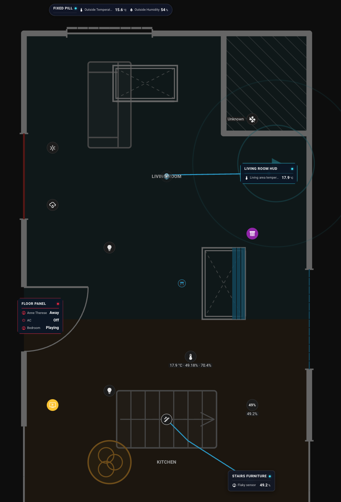
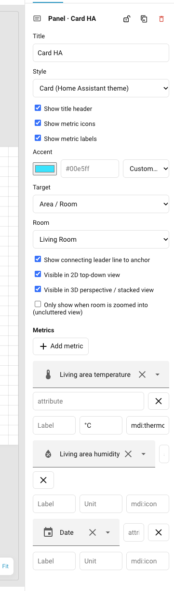

# Spatial Telemetry Callout Info-Panels

Spatial telemetry callout info-panels ([GitHub Issue #234](https://github.com/nicosandller/easy-floorplan/issues/234)) bring floating HUD cards and multi-metric telemetry into `easy-floorplan` without cluttering your floorplan layout.

Each panel is anchored to a room, furniture piece, roof, or fixed coordinate on your plan, connected by an orthogonal or angled SVG leader line in both 2D and 3D views.



## Example Configuration

```yaml
floors:
  - id: 1st
    name: First Floor
    panels:
      # Room climate panel, anchored to the living room
      - id: living_room_panel
        targetType: area
        targetId: living_room
        style: tech
        x: 180
        'y': 140
        title: Living Room
        metrics:
          - entity: sensor.living_room_temp
            label: Temperature
            icon: mdi:thermometer
          - entity: sensor.living_room_humidity
            label: Humidity
            icon: mdi:water-percent
          - entity: sensor.living_room_co2
            label: Air Quality
            icon: mdi:molecule-co2
            unit: ppm

      # Compact workstation monitor, anchored to a furniture piece
      - id: workstation_panel
        targetType: furniture
        targetId: desk_pc
        style: minimal
        color: "#ff9100"
        x: 680
        'y': 220
        title: Workstation
        metrics:
          - entity: sensor.workstation_power
            label: Power Draw
            icon: mdi:flash
          - entity: sensor.workstation_cpu_temperature
            label: CPU Temp
```

## Configuration Reference

### Panel Options

| Key | Type | Default | Description |
| --- | --- | --- | --- |
| `id` | `string` | *(required)* | Unique identifier for the panel. |
| `x` | `number` | *(required)* | Horizontal center coordinate on the canvas. |
| `y` | `number` | *(required)* | Vertical center coordinate on the canvas. |
| `title` | `string` | optional | Header title. Defaults to the linked area name, furniture type, or `Telemetry`. |
| `style` | `string` | `"tech"` | Visual presentation: `"tech"` (chamfered sci-fi HUD), `"minimal"` (rounded card), or `"pill"` (compact single-row pill). |
| `color` | `string` | optional | Accent hex/CSS color for borders, leader line, icons, and indicator glow. |
| `targetType` | `string` | `"floor"` | Spatial anchoring behavior: `"area"`, `"furniture"`, `"roof"`, `"fixed"`, or `"floor"`. |
| `targetId` | `string` | optional | Target ID of the referenced area, furniture piece, or roof. |
| `anchor` | `{ x: number, y: number }` | optional | Explicit canvas coordinates for the leader line anchor point (used with `fixed` or as an override). |
| `showLeaderLine` | `boolean` | `true` | Set to `false` to hide the SVG connecting line to the anchor point. |
| `showIn2D` | `boolean` | `true` | Set to `false` to hide the panel in 2D top-down view. |
| `showIn3D` | `boolean` | `true` | Set to `false` to hide the panel in 3D perspective / stacked view. |
| `showOnlyWhenZoomed` | `boolean` | `false` | When `true`, only renders when zoomed into the associated room. |
| `metrics` | `FloorInfoPanelMetric[]` | `[]` | List of metric rows displayed inside the panel. |

### Metric Options

| Key | Type | Default | Description |
| --- | --- | --- | --- |
| `entity` | `string` | *(required)* | Home Assistant entity ID providing state. Rows without an entity are omitted. |
| `attribute` | `string` | optional | Entity state attribute name to display instead of the primary state value. |
| `label` | `string` | optional | Row label. Defaults to entity's `friendly_name` or entity ID. |
| `unit` | `string` | optional | Unit override (e.g., `°C`, `W`, `%`). Defaults to entity `unit_of_measurement`. |
| `icon` | `string` | optional | MDI icon override (e.g., `mdi:thermometer`). Defaults to entity `icon`. |

### Anchor Targets (`targetType`)

Each panel connects to a spatial anchor point via an SVG leader line:

| `targetType` | Leader Line Target | Room Zoom Interaction |
| --- | --- | --- |
| `area` | Centroid / label point of `targetId`. If omitted, defaults to enclosing room or nearest room. | Clicking the panel zooms into the room. |
| `furniture` | Center point of the referenced furniture piece. Automatically tracks furniture movement. | Zooms into enclosing room if present. |
| `roof` | Centroid of referenced roof polygon. In 3D, projects onto the physical roof surface. | Zooms into room beneath roof if present. |
| `fixed` | Fixed canvas coordinates specified via `anchor: { x, y }`. | No zoom action. |
| `floor` | Floor-level aggregate (no leader line unless explicit `anchor` is supplied). | No zoom action. |

## 3D Perspective & Roof Stacking

In 3D view (`view: 3d`) and multi-floor outdoor stacking:
- Panels anchored to floors or rooms project at their floor's physical elevation.
- Roof panels (`targetType: roof` or linked to a roof) appear exclusively in the outside 3D house view (`active.isOutdoor && iso`) and only while that roof is visible. They are never rendered in 2D top-down or single-floor indoor 3D views, and automatically hide when zooming into the room beneath the roof.
- When visible in outside 3D view, roof panels project at the physical roof ridge and eaves elevation, ideal for exterior rooftop telemetry (e.g., solar PV generation, rooftop weather stations), with leader lines connecting directly to the 3D surface point.

## Theming & CSS Custom Properties

Info-panels maintain high legibility across dark and light themes:

| CSS Variable | Default | Description |
| --- | --- | --- |
| `--fp-panel-bg` | Chamfered dark navy / card background | Panel container background color |
| `--fp-panel-text` | `#fff` | Primary text and reading value color |
| `--fp-panel-accent` | `#00e5ff` (or panel `color`) | Accent glow, borders, status dots, and leader lines |
| `--fp-panel-border` | Translucent border | Card border styling |

In the `line-art` appearance mode, panels automatically adapt with ink-line borders and crisp monochrome styling.

## Visual Editor Support

1. **Add Panel**: Click **+ Add → Panel** in the editor toolbar to drop a panel onto the active floor. It automatically links to the room it sits within.
2. **Move Panel**: Drag the panel card anywhere on the canvas.
3. **Inspector**: Select the panel to configure title, style (`tech`, `minimal`, `pill`), accent color, target type, visibility flags, leader lines, and metric rows with live entity autocomplete and attribute selection.


