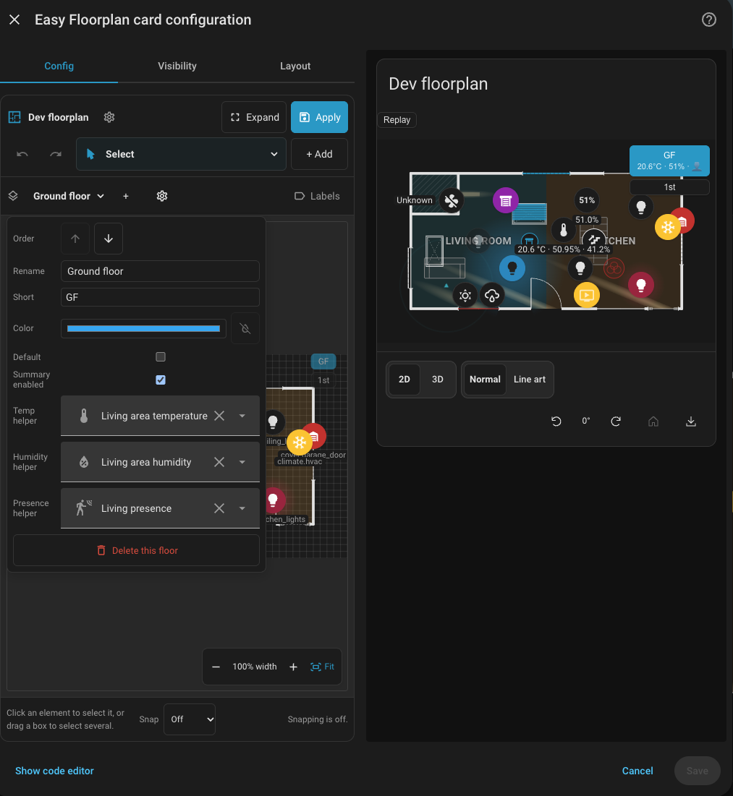

# Floor Switcher Summaries

Floor switcher summaries ([GitHub Issue #234](https://github.com/nicosandller/easy-floorplan/issues/234)) bring multi-metric status badges directly onto the floor switcher buttons, displaying climate, presence, active lights, and open windows for every floor at a glance without having to click between floors.

```yaml
type: custom:easy-floorplan-card
floorSummary:
  enabled: true
  decimals: 1
  metrics:
    - temperature
    - humidity
    - presence
    - lights
    - windows
floors:
  - id: ground
    name: Ground Floor
    summary:
      enabled: true
      temperatureEntity: sensor.ground_floor_mean_temp # optional helper override
      humidityEntity: sensor.ground_floor_humidity     # optional helper override
      presenceEntity: binary_sensor.ground_presence    # optional helper override
```

### Single-Floor Plans

Single-floor plans (such as apartments or single-storey homes) hide the floor switcher by default because floor navigation is not needed. When floor summary is enabled (either via `floorSummary.enabled: true` on the card, `summary.enabled: true` on the floor, or by configuring any floor helper entity or `customText`), the switcher is automatically displayed with a single button, providing an at-a-glance summary chip for the entire home without needing a multi-floor configuration.

## Automatic Sensor Discovery

A helper entity (`temperatureEntity`, `humidityEntity`, `presenceEntity`) always wins. A dedicated Home Assistant helper, such as a Min/Max sensor averaging the floor's thermometers, is the recommended way to set the floor's figure.

Without an explicit helper configured, the card discovers candidate sensors on the floor:
- **On the plan**: entities bound to items, readings, openings, trackers, and rooms of that floor.
- **Room / Area linkage**: every entity in the Home Assistant area linked to a room (`area.haArea`), including entities whose device is assigned to that area.
- **Floor-level linkage**: every entity in the Home Assistant areas on the floor's linked Home Assistant floor (`floor.haFloor`).

Sensors are recognized strictly by their `device_class` and unit, never by entity name alone, ensuring non-telemetry sensors (e.g. battery or signal strength) are not mistakenly counted:
- **Temperature**: `sensor` entities with `device_class: temperature`, a `°C`/`°F` unit (or `K` when accompanied by `device_class: temperature`), and `climate` entities (`current_temperature`). When mixed units are encountered, temperatures are converted to the unit of the first discovered entity with a unit and rounded to `decimals`.
- **Humidity**: `sensor` entities with `device_class: humidity`, and `climate` entities with `current_humidity`.
- **Presence**: `binary_sensor` entities with `device_class` `occupancy`, `motion`, or `presence`, plus `person` and `device_tracker` entities. Discovered motion or occupancy sensors render as a plain `👤`, while `N` counts `person` entities only (`👤 N`).
- **Lights on**: `light` entities that are on (`💡 N`).
- **Openings**: physical openings drawn on the plan, and `door`, `window`, `garage_door`, or `opening` binary sensors that are currently open (`🪟 N`).

Use `summary.excludeEntities` to exclude specific sensors (for example, a garage or exterior patio thermometer), and `summary.customText` to customize the badge string with `{temp}`, `{humidity}`, `{presence}`, `{lights}`, and `{windows}` placeholders.

## Configuration Options

| Key | Where | Description |
| --- | --- | --- |
| `floorSummary.enabled` | card | Show summaries on every floor (default `false`). |
| `floorSummary.metrics` | card | Which of `temperature`, `humidity`, `presence`, `lights`, `windows` to show (default: all five). |
| `floorSummary.decimals` | card | Decimal places for temperature averaging (default `1`). |
| `summary.enabled` | floor | Turn this floor's summary on or off, overriding the card setting. |
| `summary.temperatureEntity` / `humidityEntity` / `presenceEntity` | floor | Helper entity used instead of discovery. Setting one also turns the summary on for that floor. |
| `summary.excludeEntities` | floor | Entity IDs excluded from discovery. |
| `summary.customText` | floor | Custom badge text template with `{temp}`, `{humidity}`, `{presence}`, `{lights}`, `{windows}`. |

## Visual Editor Integration



1. Click the floor settings button (the cog icon beside the floor name) in the editor header.
2. Toggle **Summary enabled** with a single click.
3. When enabled, optional helper entity pickers (**Temp helper**, **Humidity helper**, **Presence helper**) expand immediately if you prefer to use dedicated Home Assistant Min/Max helpers. When disabled, the helpers remain hidden and summary computations for that floor are omitted.
