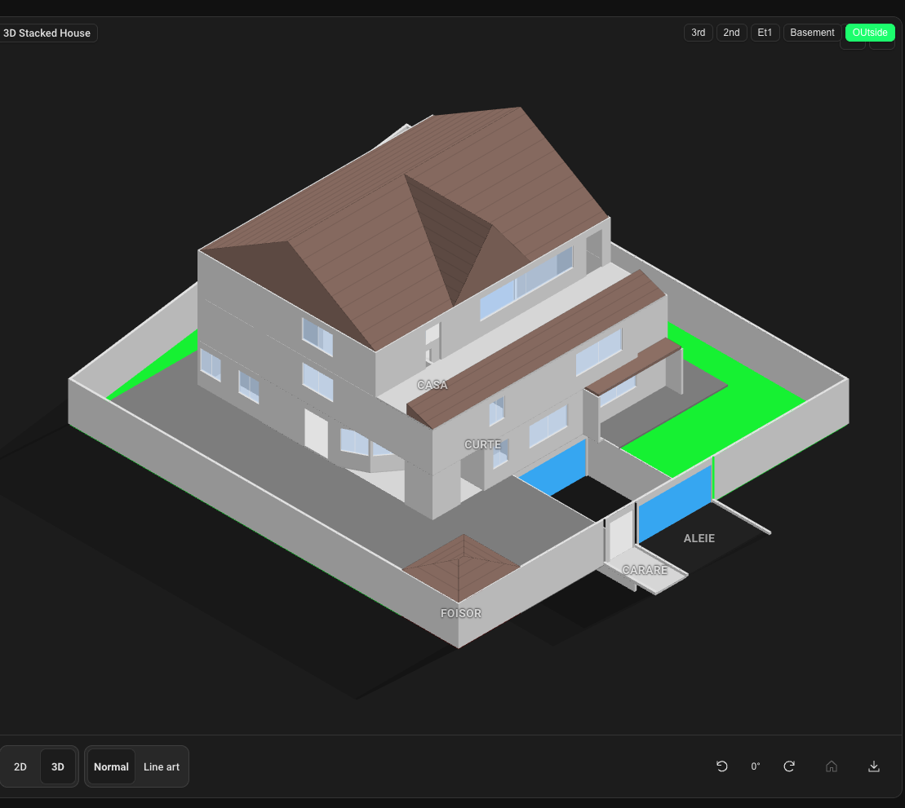

# Outdoor Courtyard, Multi-Floor 3D Stacking & Roof Technical Specification

Technical design specification for implementing outdoor courtyard areas, multi-floor vertical 3D stacking (leveraging Home Assistant native floors), custom outdoor zone assignments, and roof rendering with ambient daylight integration.



---

## 1. Feature Architecture Overview

```
                        +--------------------------------+
                        |  Home Assistant Floor Registry |
                        |  (Native HA Floor Ordering)    |
                        +---------------+----------------+
                                        |
                                        v
+------------------------+  +------------------------+  +------------------------+
| Courtyard & Outdoor    |  | Multi-Floor 3D Stack   |  | Roof & Elevation       |
| Area Layer             |  | Elevation Calculation  |  | Geometry Engine        |
| - Custom Outdoor Zones |  | - Native HA Z-Offsets  |  | - Gable / Hip / Flat   |
| - Plant & Light Sensors|  | - Stacked Wall Envelope|  | - Roof Pitch & Shading |
+-----------+------------+  +-----------+------------+  +-----------+------------+
            |                           |                           |
            +---------------------------+---------------------------+
                                        |
                                        v
                        +--------------------------------+
                        |  Ambient Daylight & Shadow     |
                        |  Polygon Generator             |
                        |  (Courtyard & Multi-Story)     |
                        +--------------------------------+
```

---

## 2. Core Components & Module Breakdown

### 2.1 Data Models & Configuration (`src/types.ts`)

- **Outdoor & Courtyard Layer**:
  - Add optional `isOutdoor?: boolean` or `kind?: "courtyard" | "indoor"` to floor structures.
  - Allow defining custom outdoor zones (e.g. Lawn, Patio, Swimming Pool, Terrace, Driveway).
- **Native HA Floor Stacking**:
  - Use Home Assistant's native floor ordering/hierarchy (`floor_id` / floor index) to establish vertical ordering without duplicate manual indices.
  - Optional `elevationOffset?: number` per floor to accommodate non-standard ceiling heights.
- **Roof Specifications**:
  - Define `RoofConfig` interface supporting roof type (`gable`, `hip`, `flat`), pitch angle, overhang, and color/texture fallbacks.

### 2.2 3D Projection & Elevation (`src/projection.ts` & `src/projection-joints.ts`)

- **Cumulative Z-Base Calculation**:
  - Update `DisplayFrame` and `IsoWallInput` to compute baseline Z-offsets (`z0`, `z1`) per floor based on HA floor order:
    \[
    z_0(f) = \sum_{k < f} \text{wallHeight}(k)
    \]
  - Stack exterior and interior walls across visible floors to render a complete multi-story building shell under isometric (`projection: "iso"`) view.
- **Roof Solid Generation**:
  - Implement `roofSolids(...)` returning `IsoSolid` polygons with sloping triangular/quadrilateral faces for gables and hips.

### 2.3 Ambient Daylight & Shadow System (`src/ambient-daylight.ts` & `src/render.ts`)

- **Courtyard Surface Shading**:
  - Extend daylight polygon calculation so sun shadows cast by multi-story walls, roof eaves, and outdoor fences render naturally onto courtyard ground surfaces.
- **Light Occlusion across Levels**:
  - Ensure lamp light and outdoor sunlight interact correctly with elevated balconies, railings, and stacked floor slabs.

### 2.4 Interactive Visual Editor (`src/editor.ts` & `src/editor-forms.ts`)

- **Courtyard & Zone Tools**: Add drawing tools and form specifications for creating outdoor boundaries and styling zone fills.
- **Roof Property Editors**: Provide controls for toggling roof visibility, selecting roof style, and setting pitch/overhang options.

---

## 3. Implementation Status & Feature Matrix

All core phases have been fully implemented, verified, and integrated into `easy-floorplan`:

- [x] **Phase 1 — Outdoor Courtyard & Custom Zones**:
  - `isOutdoor?: boolean` floor toggle in config and visual editor.
  - Outdoor area zone kinds (`lawn`, `patio`, `terrace`, `driveway`, `garden`, `pool`) with distinct background fills and styling.
  - Outdoor area rendering and ground-level terrain slabs.
- [x] **Phase 2 — Multi-Floor 3D Stacking via HA Floors**:
  - `resolveFloorLevel(...)` detects floor elevation from explicit `floor.level`, falling back to Home Assistant native floor registry (`haFloor`) `level`, and finally indoor floor array order.
  - Level-based vertical stacking: $z_{\text{offset}} = (L - L_{\text{base}}) \times \text{outdoorWallHeight}$.
  - Shifted 3D solids via `shiftIsoSolidZ(solid, zOffset)` for exterior walls, doors/windows, floor slabs, and roofs.
  - Full-height door and window wall headers/lintels above openings (`z \in [sill + height, wallHeight]`).
  - Inter-floor slab solids ($Z \in [zOffset - 6, zOffset]$) for upper levels with automatic dead-space boundary fallbacks.
  - Cumulative multi-story canvas headroom scaling in `_frame(...)`.
- [x] **Phase 3 — Extended Ambient Daylight & Building Shadows**:
  - Outdoor direct sunlight (`renderOutdoorSunlight`) providing ambient sky daylight across open ground.
  - Directional building wall shadows (`sunShadowPolygon`) cast across the outdoor floor based on sun azimuth (`dir`) and elevation (`reach`).
  - Suppression of indoor window beam cutouts on outdoor ground surfaces.
- [x] **Phase 4 — Roof Geometry Engine & Interactive Focus**:
  - 3D Roof solids supporting `flat`, `gable`, `hip`, and `shed` (with `top`, `bottom`, `left`, `right` slope directions).
  - Configurable roof pitch, elevation, overhang, and color picker (`ha-selector-color`) in editor properties.
  - Scope constraint: 3D roofs render exclusively on outdoor floor views (`isOutdoor: true`), keeping indoor floor views unobstructed.
  - Interactive 3D roof buttons (`.fp-iso-roof-button`) allowing clicking on roofs to zoom into rooms.
  - **Dynamic Roof Auto-Hide**: Zooming or focusing into any area (`_zoomedAreaId === area.id`) automatically hides its roof, exposing internal room furniture, lights, state badges, and sensors.

---

## 4. Testing & Quality Assurance

- **Node Unit Tests (`npm test`)**:
  - Validates `shiftIsoSolidZ` and multi-story Z-offset transformations.
  - Validates roof polygon generation for flat, hip, gable, and directional shed roofs in `src/projection.test.ts`.
  - Validates `renderOutdoorSunlight` building shadow polygons and sun reach calculations.
- **Browser Tests (`npm run test:browser`)**:
  - Real Chromium tests validating interactive 3D roof buttons, gesture capture, floor switching, and zoom focus.
- **Type Checking (`npm run typecheck`)**:
  - Verified 0 errors across dual TypeScript projects (`tsconfig.json` and `tsconfig.node.json`).

---

## 5. Architectural Deep-Dive: Implemented Functionalities

### 5.1 Multi-Level 3D Building Shell, Basements & Slabs
When viewing an outdoor floor (`isOutdoor: true`), `_renderIsoLayer` groups indoor floors by their resolved HA floor level:
1. **Vertical Level Offsets**:
   \[
   z_{\text{offset}} = (L - L_{\text{base}}) \times \text{outdoorWallHeight}
   \]
   Where `outdoorWallHeight = baseWallHeight * 2.5`. Both positive upper floors ($L > L_{\text{base}}$) and negative subterranean floors ($L < L_{\text{base}}$, such as basements) are naturally supported.
2. **Subterranean Headroom & Canvas Scaling**:
   In `_frame(...)`, `lowerDepth` dynamically extends the canvas viewport downward whenever lower/basement levels exist ($L_{\text{base}} - \min(L)$), ensuring underground ramps and walkout garage walls remain within view without clipping.
3. **Subterranean Exposure & Occlusion**:
   Lower-level areas completely covered by upper-level room slabs are culled using `isAreaCoveredByUpper`. Subterranean foundation walls beneath ground level are occluded naturally by the isometric painter's algorithm order and ground slabs ($z_0 = -6, z_1 = 0$), while exposed walkout walls (such as basement walkout garage doors or open ramps) remain visible.
4. **Floor Slabs**:
   Extrudes horizontal slab boxes ($Z \in [zOffset - 6, zOffset]$) using either the level's area polygons or boundary wall loops (`deadSpaces(lvlWalls, [])`). Ground slabs on the outdoor terrain are assigned $z_0 = -6, z_1 = 0$.
5. **Exterior Walls & Openings**:
   Draws full-height walls with lintels spanning above door/window openings (`openingSolids`), de-duplicating outdoor walls overlapping indoor perimeter walls via `isSameWallSegment`.

### 5.2 Dynamic Roof Auto-Hide on Area Focus
To inspect what is inside a covered area (such as a patio or a room under a roof) without toggling configuration:
- In 3D isometric mode, clicking on a 3D roof solid triggers `_onAreaAction` and focuses into the area (`this._zoomedAreaId = area.id`).
- When an area is focused, `_renderIsoLayer` filters that area out from `roofSolids(unzoomedAreas(areas), ...)`.
- The roof seamlessly disappears and the camera zooms in, revealing all indoor details, furniture, sensors, and state badges.
- Tapping the area again, clicking the zoom reset button, or pressing <kbd>Esc</kbd> unzooms and restores the roof.

### 5.3 Outdoor Direct Sunlight & Building Wall Shadows
Indoor floors use window light beams cutting through shade masks. Outdoor floors instead use `renderOutdoorSunlight`:
- The courtyard/patio ground remains in open sunlight.
- The external building envelope walls project shadow polygons (`sunShadowPolygon`) swept along the sun's travel vector (`dir = sunLightDirection(cfg, azimuth)`).
- Shadow reach scales with sun elevation (`reach = min(w, h) * sunReachFraction * sunReachScale(elevation)`), causing shadows to realistically lengthen at dawn/dusk and contract at noon.

### 5.4 Cross-Gable Roof Intersections & Tile Course Shading
The roof geometry engine (`roofSolids`) supports `flat`, `hip`, `gable`, and `shed` styles, as well as automatic cross-gable roof intersections:
1. **Intersection Detection**:
   When multiple gable roof areas overlap with perpendicular ridge orientations (one aligned along X, one along Y), `roofSolids` identifies main roofs and penetrating cross gables (dormers or wings).
2. **Valley Seam & Apex Calculation (`generateIntersectingGables`)**:
   - Calculates ridge apex elevation $z_{\text{apex}} = \min(z_{\text{peakA}}, z_{\text{peakB}})$ and valley plan coordinate $v_{\text{apex}} = \text{midV}_A \pm (z_{\text{peakA}} - z_{\text{apex}})/\text{slope}_A$.
   - Generates dual sloping valley faces meeting the main roof, side gable faces, and triangular infill pediments when dormer peaks are subordinate to the main roof peak.
3. **Horizontal Tile Course Lines (`roofCourseLines`)**:
   Sloped roof polygons generate contour lines running at constant $Z$ intervals across each face, providing the appearance of horizontal roof tile courses or standing seams.
4. **Directional Shading**:
   Roof face normal vectors ($\vec{n}$) determine solar shade factors (`SHADE_FRONT`, `SHADE_RIGHT`), adding realistic three-dimensional depth.

### 5.5 Ground Terrain Slabs & Topological Depth Ordering
In isometric projection, rendering overlapping 3D polygons without z-buffer artifacts requires topological sorting:
1. **Total Order for Ground Terrain Slabs**:
   In `sortIsoSolids`, ground slabs (`slab_...` at $z \le 0$) have a strict total ordering based on elevation and depth. This guarantees ground terrain (lawns, patios, driveways) never enters cyclic deadlocks with other slabs.
2. **Elevation Separation**:
   Elevated structures ($z > 0$) are explicitly ordered in front of ground slabs ($z \le 0$), preventing terrain polygons from occluding building walls or roofs.
3. **Kahn Cycle-Breaking Fallback**:
   If non-convex wall geometries produce a topological cycle, Kahn's algorithm cycle breaker prioritizes discharging ground slabs first, preserving the visual integrity of elevated structures.
4. **Micro-Geometry Pruning**:
   Wall segments and opening spans are guarded by a $2\text{px}$ minimum threshold, eliminating zero-width slivers and junction post glitches at wall corners.

### 5.6 Line-Art SVG Export Parity Note
Line-art export (`createLineArtSvg` via the card's "Export SVG" button) is designed specifically to output a clean 2D or 3D architectural blueprint of an individual floor (including its interior rooms, wall cutaways, openings, and furniture). When exporting an outdoor floor, the export captures that single level's boundaries and elements rather than compositing the entire multi-story stacked building or solid roof caps, ensuring interior plans remain legible.

---

## 6. Configuration Guide & Practical YAML Patterns

### 6.1 Full Floor Roof with Sub-Area Focus (The Encompassing Roof Pattern)

When a floor (e.g. Ground Floor or 1st Floor) has multiple individual rooms (such as Living Room and Kitchen), you may want to generate a single unified roof (e.g., hip or gable) over the entire building footprint while still being able to focus on individual rooms and see their labels.

**Key Rule**: Place the encompassing roof area **first in the `areas` array** in YAML.

```yaml
floors:
  # ---------------------------------------------------------------------------
  # INDOOR FLOOR (e.g. Ground Floor)
  # ---------------------------------------------------------------------------
  - id: ground
    name: Ground floor
    haFloor: '1'          # Home Assistant floor ID
    walls:
      - { id: w1, x1: 100, y1: 100, x2: 900, y2: 100 }
      - { id: w2, x1: 900, y1: 100, x2: 900, y2: 500 }
      - { id: w3, x1: 900, y1: 500, x2: 100, y2: 500 }
      - { id: w4, x1: 100, y1: 500, x2: 100, y2: 100 }
      - { id: w_div, x1: 500, y1: 100, x2: 500, y2: 500 } # Interior partition wall
    roofs:
      # 1. DEDICATED ROOF ELEMENT
      - id: whole_house_roof
        type: hip          # hip, gable, shed, or flat
        height: 40
        elevation: 60
        overhang: 12
        color: '#8d6e63'
        points:
          - { x: 100, 'y': 100 }
          - { x: 900, 'y': 100 }
          - { x: 900, 'y': 500 }
          - { x: 100, 'y': 500 }

    areas:
      # 2. INDIVIDUAL ROOM AREAS
      - id: living_room
        name: Living Room
        showName: true
        color: var(--fp-color-living)
        opacity: 0.15
        points:
          - { x: 100, 'y': 100 }
          - { x: 500, 'y': 100 }
          - { x: 500, 'y': 500 }
          - { x: 100, 'y': 500 }

      - id: kitchen
        name: Kitchen
        showName: true
        color: var(--fp-color-kitchen)
        opacity: 0.15
        points:
          - { x: 500, 'y': 100 }
          - { x: 900, 'y': 100 }
          - { x: 900, 'y': 500 }
          - { x: 500, 'y': 500 }

  # ---------------------------------------------------------------------------
  # OUTDOOR FLOOR (3D View of entire house + courtyard)
  # ---------------------------------------------------------------------------
  - id: outside
    name: Outside & Courtyard
    haFloor: '0'          # Base level
    isOutdoor: true       # Activates outdoor mode: renders 3D building stack + roofs + shadows
    walls:
      - { id: fence_1, x1: 0, y1: 0, x2: 1000, y2: 0 }
    roofs:
      - id: patio_roof
        type: shed             # Patio can have its own shed/pergola roof
        highSide: top
        height: 20
        elevation: 60
        color: '#a1887f'
        points:
          - { x: 800, 'y': 460 }
          - { x: 1000, 'y': 460 }
          - { x: 1000, 'y': 600 }
          - { x: 800, 'y': 600 }
    areas:
      - id: patio_zone
        name: Patio
        showName: true
        zoneKind: patio
        points:
          - { x: 800, 'y': 460 }
          - { x: 1000, 'y': 460 }
          - { x: 1000, 'y': 600 }
          - { x: 800, 'y': 600 }

      - id: lawn_zone
        name: Garden Lawn
        showName: true
        zoneKind: lawn
        points:
          - { x: 0, 'y': 0 }
          - { x: 1000, 'y': 0 }
          - { x: 1000, 'y': 460 }
          - { x: 0, 'y': 460 }
```

### 6.2 Real-World Implementation Example: 3-Level House with Basement & Courtyard

A full production configuration demonstrating a 3-level stacked home with subterranean garage/basement, cross-gable roof intersections, courtyard perimeter fence, and gazebo is available in [`src/fixtures/3floorHouse.yaml`](file:///Users/andrei.prescornic/Personal/Casa/HomeAssystant/easy-floorplan/src/fixtures/3floorHouse.yaml).

**Highlights of this setup**:
- **Level 2 (`2nd`)**: Primary cross-gable roofs (`HouseRoof` along X and `HouseSmallRoof` along Y) intersecting with automatic valley seams and gable pediments.
- **Level 1 (`1st`)**: Upper living spaces stacked directly on the foundation.
- **Level -1 (`Basement`)**: Subterranean level with garage and driveway ramp (`Rampa`); underground walls covered by Level 1 are culled while the driveway entrance ramp remains visible in 3D.
- **Ground Floor (`Outside`)**: Marked `isOutdoor: true`, containing courtyard perimeter fence walls, driveway gate, garden lawn (`Gradina`), walkway (`Aleie`), and a gazebo (`Foisor`) with a custom shed roof.
- **Visual Proof**: Captured in [`3D_house_rendering.png`](img/3D_house_rendering.png):

  
